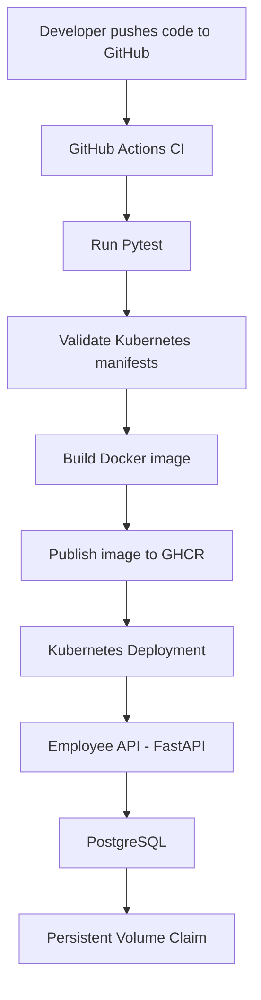

# Employee Management API

A containerized Employee Management REST API built with **Python, FastAPI, SQLAlchemy, and PostgreSQL**. This project demonstrates application development, automated testing, Docker, CI/CD with GitHub Actions, and Kubernetes deployment.

## Architecture



## Technology Stack

| Component | Technology |
|---|---|
| Language | Python 3.13 |
| API framework | FastAPI |
| ORM | SQLAlchemy |
| Database | PostgreSQL 16 / SQLite |
| Testing | Pytest |
| Containerization | Docker |
| Local orchestration | Docker Compose |
| CI/CD | GitHub Actions |
| Container registry | GitHub Container Registry (GHCR) |
| Container security | Trivy |
| Orchestration | Kubernetes |
| Manifest validation | Kubeconform |

## Project Structure

```text
employee-api-devops/
├── .github/
│   └── workflows/
│       └── ci.yml
├── app/
│   ├── config.py
│   ├── database.py
│   ├── main.py
│   ├── models.py
│   └── schemas.py
├── k8s/
│   ├── configmap.yaml
│   ├── database.yaml
│   ├── deployment.yaml
│   ├── postgres-pvc.yaml
│   ├── service.yaml
│   ├── setup-ghcr-secret.ps1
│   └── README.md
├── tests/
├── .dockerignore
├── .env.example
├── .gitignore
├── compose.yaml
├── Dockerfile
└── requirements.txt
```

## API Endpoints

| Method | Endpoint | Description |
|---|---|---|
| GET | `/` | API welcome message |
| GET | `/health` | Health check |
| POST | `/employees` | Create an employee |
| GET | `/employees` | List employees |
| GET | `/employees/{employee_id}` | Retrieve an employee |
| DELETE | `/employees/{employee_id}` | Delete an employee |

Interactive API documentation is available at `/docs` when the application is running.

## Run Locally with Docker Compose

### Prerequisites

- Git
- Docker Desktop with Docker Compose
- Python 3.13 (for running tests outside Docker)

### 1. Clone the repository

```bash
git clone https://github.com/rk-Swetha/employee-api-devops.git
cd employee-api-devops
```

### 2. Configure environment variables

Create your local environment file:

```powershell
Copy-Item .env.example .env
```

Update `.env` with a local database password. Do not commit this file.

### 3. Start the application

```powershell
docker compose up --build -d
```

### 4. Verify the application

Open:

- API: http://localhost:8000/
- Health check: http://localhost:8000/health
- API documentation: http://localhost:8000/docs

### 5. View logs

```powershell
docker compose logs -f
```

### 6. Stop the application

```powershell
docker compose down
```

The PostgreSQL data is stored in a named Docker volume. To remove the volume and its database data as well:

```powershell
docker compose down -v
```

**Warning:** The `-v` option permanently removes the Compose database volume.

## Run Tests

Create and activate a Python virtual environment, then install dependencies:

```powershell
python -m venv .venv
.\.venv\Scripts\Activate.ps1
python -m pip install -r requirements.txt
```

Run the test suite:

```powershell
python -m pytest -v
```

## CI/CD Pipeline

GitHub Actions runs the workflow defined in `.github/workflows/ci.yml` on pushes and pull requests targeting `main`.

The pipeline performs these steps:

1. Checks out the repository.
2. Sets up Python 3.13 and installs dependencies.
3. Runs the Pytest test suite.
4. Sets up Go and validates Kubernetes manifests using Kubeconform.
5. Builds the Docker image using Docker Buildx.
6. On pushes to `main`, authenticates with GHCR and publishes the image.

Published image:

```text
ghcr.io/rk-swetha/employee-api-devops:latest
```

The workflow also generates commit-based image tags.

## Kubernetes Deployment

The Kubernetes manifests are stored in the `k8s/` directory.

The deployment includes:

- FastAPI application Deployment.
- PostgreSQL Deployment and ClusterIP Service.
- Persistent Volume Claim for PostgreSQL data.
- ConfigMap for application configuration.
- Kubernetes Secret for database credentials.
- GHCR image pull secret for private image access.
- Readiness and liveness probes.
- CPU and memory requests and limits.
- Non-root container execution and security restrictions.

### 1. Configure GHCR authentication

Follow the instructions in [`k8s/README.md`](k8s/README.md) to create the `ghcr-secret` using the PowerShell setup script.

### 2. Apply Kubernetes manifests

Ensure the following prerequisites exist first:

- `employee-db-secret` containing the database credentials and `DATABASE_URL`.
- `ghcr-secret` for pulling the private GHCR image.

Follow [`k8s/README.md`](k8s/README.md) to configure GHCR authentication.

Apply the configuration and database resources:

```powershell
kubectl apply -f .\k8s\configmap.yaml
kubectl apply -f .\k8s\postgres-pvc.yaml
kubectl apply -f .\k8s\database.yaml
```

Wait for PostgreSQL to become ready:

```powershell
kubectl rollout status deployment/employee-db --timeout=180s
```

Then deploy the API and its Service:

```powershell
kubectl apply -f .\k8s\deployment.yaml
kubectl apply -f .\k8s\service.yaml
```

Check the API rollout:

```powershell
kubectl rollout status deployment/employee-api --timeout=180s
```

### 3. Check deployment status

```powershell
kubectl get pods
kubectl get deployments
kubectl get services
kubectl get pvc
```

### 4. Access the API

Port-forward the API Deployment:

```powershell
kubectl port-forward deployment/employee-api 8001:8000
```

In another terminal:

```powershell
Invoke-RestMethod http://localhost:8001/health
```

Open API documentation at http://localhost:8001/docs.

The API Service is also exposed as a NodePort on port `30080`, depending on the Kubernetes environment.


### 3. Check deployment status

```powershell
kubectl get pods
kubectl get deployments
kubectl get services
kubectl get pvc
```

### 4. Access the API

```powershell
kubectl port-forward deployment/employee-api 8001:8000
```

In another terminal, verify:

```powershell
Invoke-RestMethod http://localhost:8001/health
```

Open API documentation at http://localhost:8001/docs.

### 5. View application logs

```powershell
kubectl logs deployment/employee-api --tail=50
```

### 6. Check rollout status and history

```powershell
kubectl rollout status deployment/employee-api
kubectl rollout history deployment/employee-api
```

### 7. Roll back a deployment

```powershell
kubectl rollout undo deployment/employee-api
```

## Container Security

The application image includes several hardening measures:

- Runs as a non-root user (`10001:10001`).
- Uses a read-only root filesystem in the Kubernetes deployment.
- Disables privilege escalation.
- Drops Linux capabilities.
- Uses the Kubernetes `RuntimeDefault` seccomp profile.
- Keeps database credentials outside the application image.
- Uses Trivy to scan container images for vulnerabilities.

## Troubleshooting

| Issue | Checks |
|---|---|
| API is not responding | Check container or pod status and application logs |
| Database connection failure | Check PostgreSQL pod, Service, endpoints, and credentials |
| `ImagePullBackOff` | Verify GHCR package access and `ghcr-secret` |
| PVC not bound | Inspect PVC and storage events |
| Pod readiness failure | Inspect readiness probe and pod logs |
| CI pipeline failure | Review the failed GitHub Actions step |

Useful commands:

```powershell
kubectl get pods
kubectl get events --sort-by=.metadata.creationTimestamp
kubectl describe pod <pod-name>
kubectl logs <pod-name>
kubectl get endpoints employee-db
```

## Learning Outcomes

This project demonstrates practical experience with:

- Building and testing REST APIs using FastAPI.
- Integrating an application with PostgreSQL using SQLAlchemy.
- Containerizing applications with Docker.
- Managing local multi-container environments with Docker Compose.
- Automating testing and image publishing using GitHub Actions.
- Publishing and pulling private images through GHCR.
- Deploying and operating applications on Kubernetes.
- Managing Kubernetes configuration, Secrets, and persistent storage.
- Troubleshooting application and infrastructure issues.
- Scanning and hardening container images.

## Author

**Swetha R.K.**

GitHub: [rk-Swetha](https://github.com/rk-Swetha)
